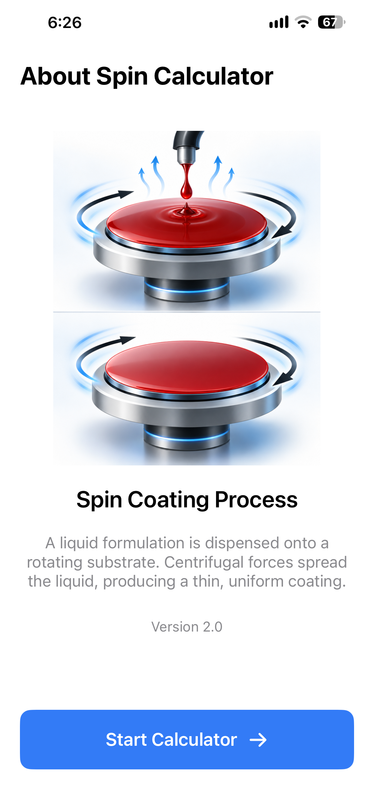
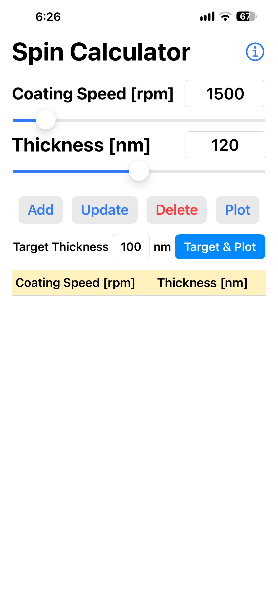
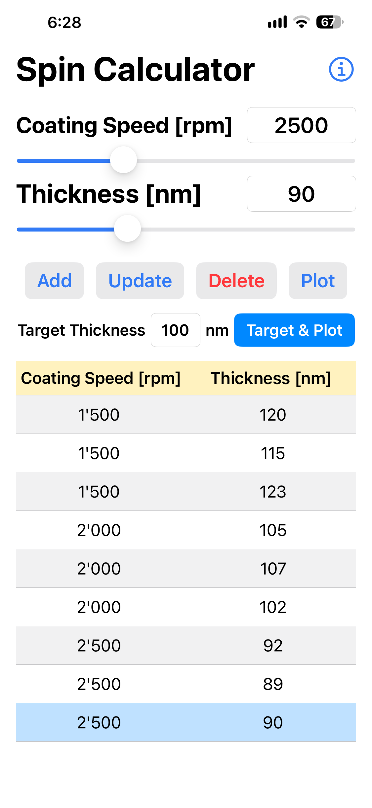
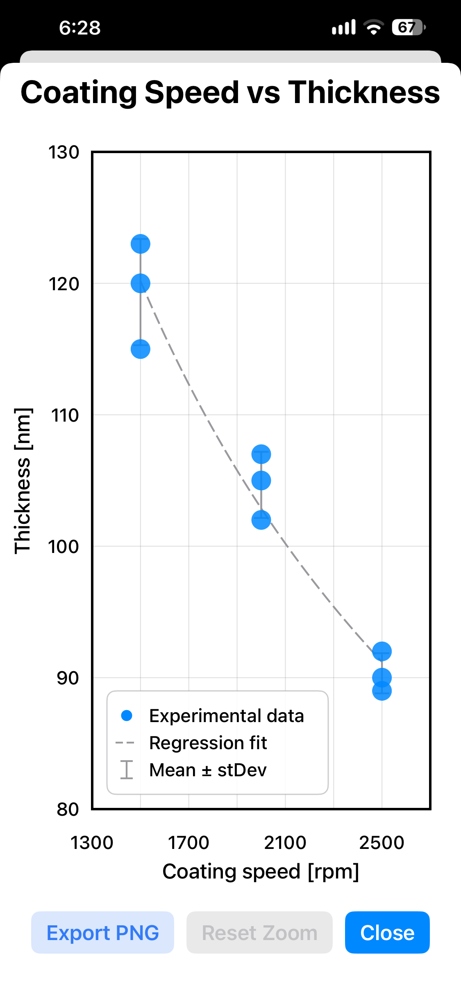
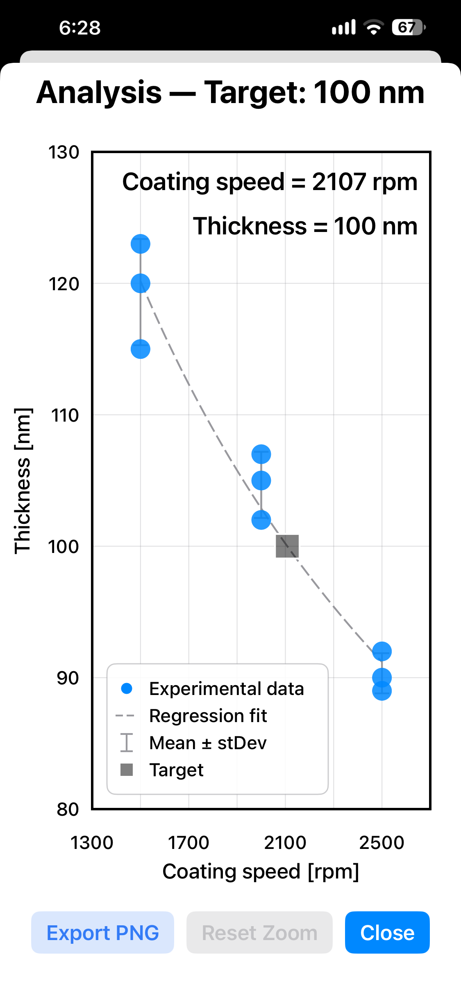
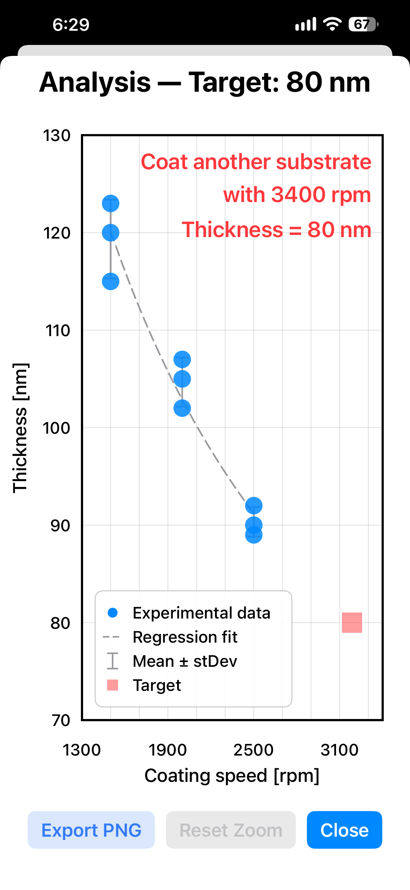

# Spin Calculator — iOS App

A native iOS version of the **Spin Calculator** application for estimating spin-coating conditions and visualizing coating-speed/thickness relationships.

This app is written in **Swift / SwiftUI** and is the iOS counterpart of the Android Spin Calculator contained in the same repository.

## Features

- Enter and adjust **Coating Speed [rpm]** and **Thickness [nm]**
- Add, update, select, and delete experimental data points
- Display experimental data in a table
- Calculate a **log-log regression** between coating speed and film thickness
- Calculate mean thickness and standard deviation for repeated RPM values
- Estimate the coating speed required for a selected **target thickness**
- Plot:
  - experimental data
  - regression fit
  - mean ± standard deviation
  - target thickness / calculated coating speed
- Pinch-to-zoom and drag/pan plot interaction
- Double-tap plot zoom
- Reset plot zoom
- Export plots as high-resolution PNG files
- Portrait and landscape support
- About / welcome screen with spin-coating illustration


---

## Screenshot












---

## Project Structure

```text
iOS_App/
├── CoatingSpeedApp.xcodeproj
└── CoatingSpeedApp/
    ├── CoatingSpeedAppApp.swift
    ├── ContentView.swift
    ├── SpinData.swift
    ├── SpinCalculatorModel.swift
    ├── PlotView.swift
    ├── AboutView.swift
    └── Assets.xcassets
```

### Main Files

- **CoatingSpeedAppApp.swift**  
  Application entry point and startup/welcome-screen handling.

- **ContentView.swift**  
  Main user interface containing the coating-speed and thickness controls, action buttons, target-thickness calculation, and experimental-data table.

- **SpinData.swift**  
  Data structures used for experimental points, statistics, and regression results.

- **SpinCalculatorModel.swift**  
  Handles the experimental data, regression calculation, statistics, and data-management logic.

- **PlotView.swift**  
  Displays the experimental data, regression curve, statistics, target point, interactive zoom/pan controls, and high-resolution PNG export.

- **AboutView.swift**  
  Welcome/About screen and spin-coating process illustration.

- **Assets.xcassets**  
  App icons and graphical assets.

## Requirements

- macOS with Xcode
- Swift
- SwiftUI
- iOS 18 or later

## Open the Project

Clone the repository:

```bash
git clone https://github.com/BrindabanKundu/CoatingSpeedApp.git
```

Move to the iOS project directory:

```bash
cd CoatingSpeedApp/iOS_App
```

Open the Xcode project:

```bash
open CoatingSpeedApp.xcodeproj
```

Alternatively, open `CoatingSpeedApp.xcodeproj` directly from Finder.

## Build and Run

1. Open the project in Xcode.
2. Select the **CoatingSpeedApp** target.
3. Select an iPhone simulator or a connected iPhone.
4. Configure your Apple Development Team under **Signing & Capabilities** if running on a physical device.
5. Press **Run** in Xcode.

## How the Calculation Works

The app models the relationship between coating speed and film thickness using a log-log linear regression:

```text
log10(Thickness) = slope × log10(RPM) + intercept
```

For a requested target thickness, the coating speed is calculated from:

```text
RPM = 10^((log10(Target Thickness) - intercept) / slope)
```

The calculated result is then compared with the experimentally measured RPM range.

## Plot Interpretation

The plot can contain:

- **Experimental data** — individual measured coating-speed/thickness values
- **Regression fit** — fitted relationship between RPM and thickness
- **Mean ± stDev** — mean and standard deviation for repeated measurements at the same RPM
- **Target** — requested target thickness and calculated coating speed

Target information is visually distinguished when the requested value is outside the measured experimental range.

## Repository Organization

This repository is intended to contain both platform implementations:

```text
CoatingSpeedApp/
├── Android_App/
└── iOS_App/
```

- `Android_App` contains the Python/Kivy Android implementation.
- `iOS_App` contains the native SwiftUI iOS implementation.

## Version

Current iOS application version: **2.0**

## Author

**Brindaban Kundu**

GitHub: [BrindabanKundu](https://github.com/BrindabanKundu)

## License

This project is licensed under the MIT License. See the [LICENSE](LICENSE) file for details.
